# GuitarFlex — Gitar Akademisi

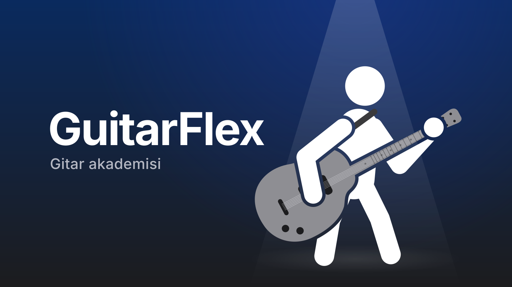

**GuitarFlex** is a guitar academy I designed and built: a desktop app (Electron) and a website (Next.js) running from a single codebase.
It takes a player from the first chord to neoclassical sweep arpeggios through 12 structured technique courses, explains the music theory
behind every exercise, and adds a songs & solos library, backing tracks for improvisation and a Songsterr-style multi-track tab player.

| Ana sayfa | Menü |
|---|---|
|  |  |
| **Kurs** | **Ders** |
| 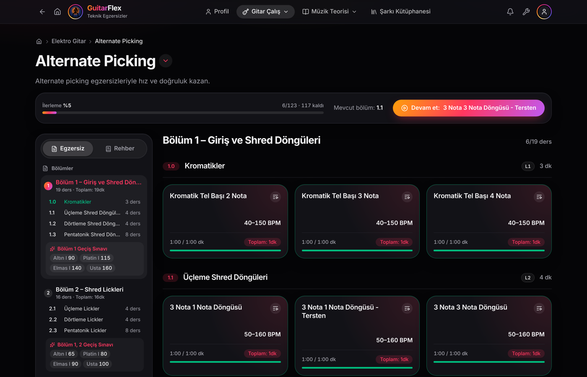 | 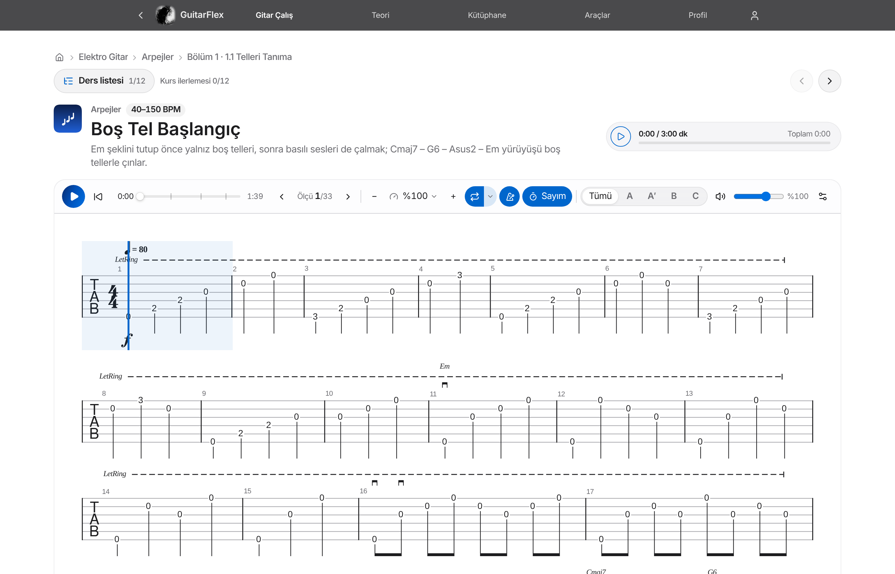 |
| **Popüler Şarkılar** | **Doğaçlama Çal** |
| 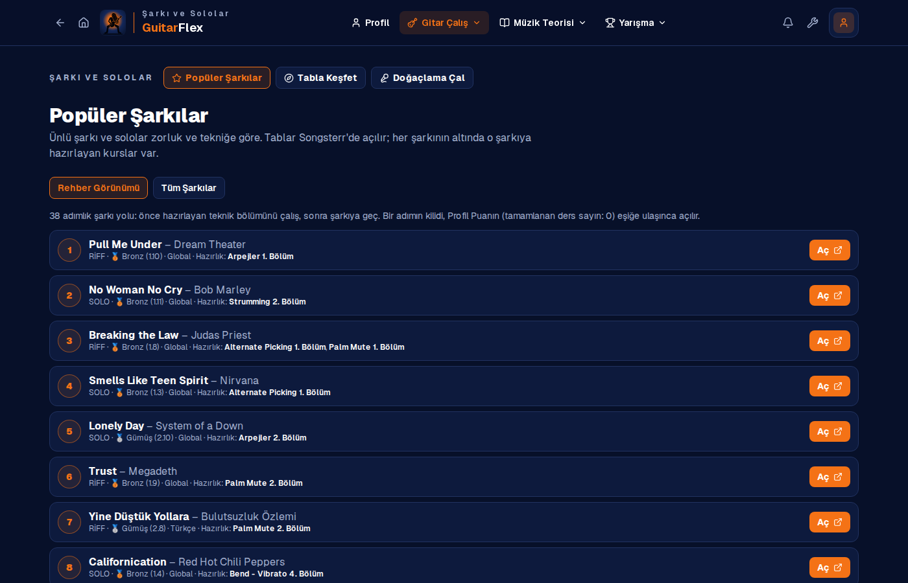 | 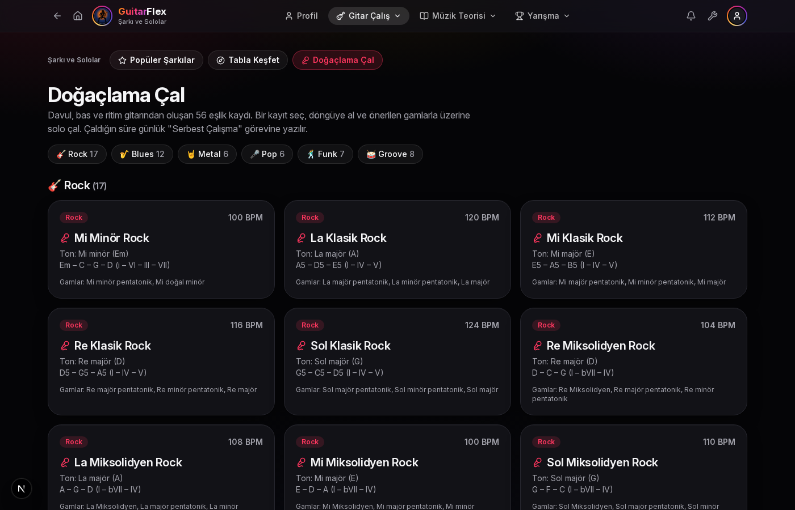 |
| **Tab oynatıcı** | **Müzik teorisi** |
| 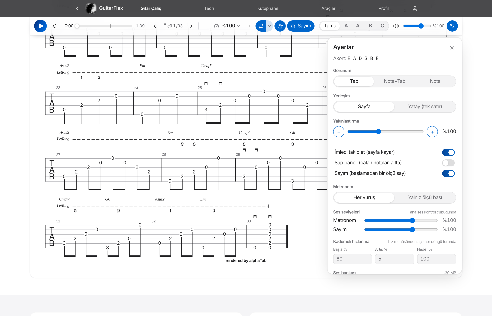 | 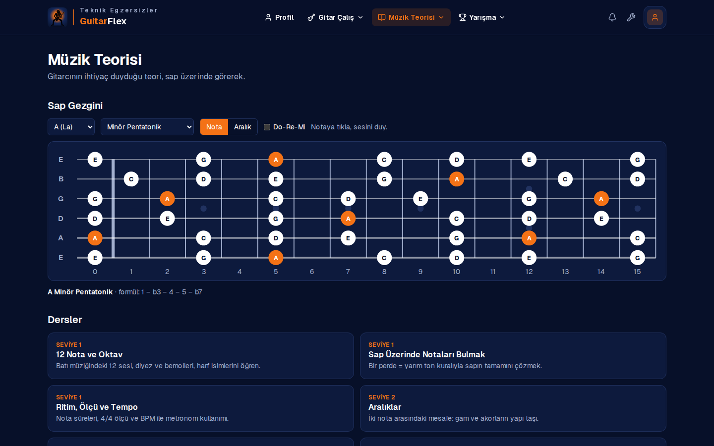 |
| **Klavye Görselleştirme yolu** | **Sapta soru (CAGED)** |
|  | 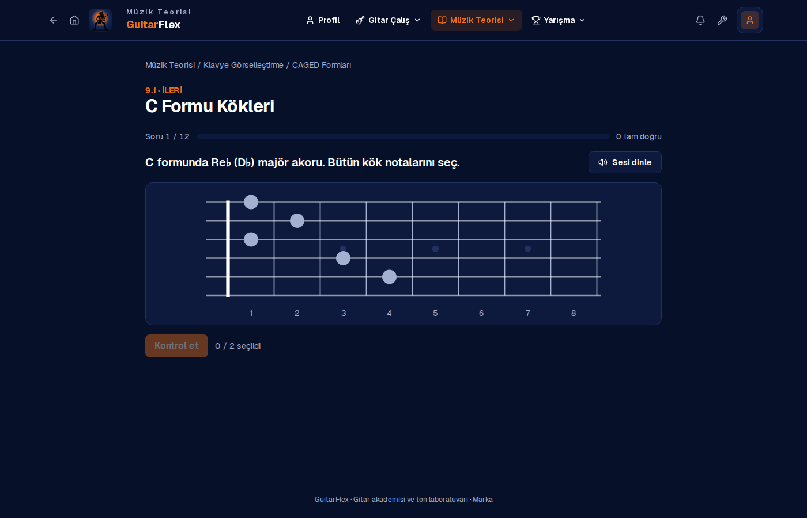 |
| **Ritim: dinle, seç, vur** | **Armoni dersleri** |
|  | 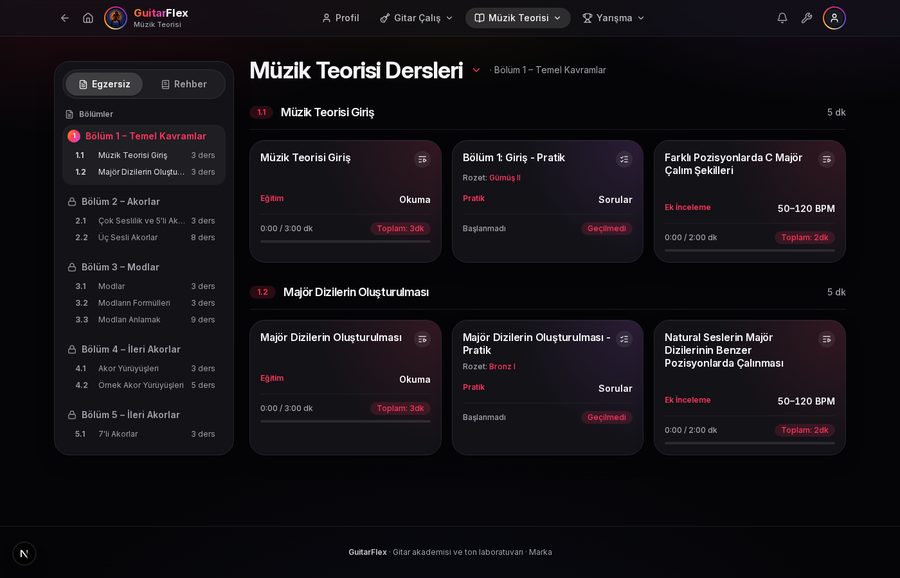 |
| **Profil: görevler, seri, başarımlar** | **Seviye Yolu** |
|  | 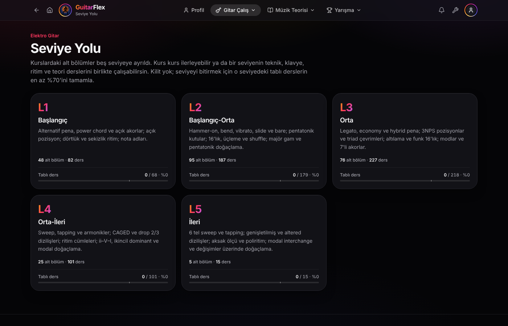 |
| **Seviye sayfası: eksenler ve bitirme koşulu** | **Uzun egzersiz: dört kısım, 20–30 ölçü** |
|  | 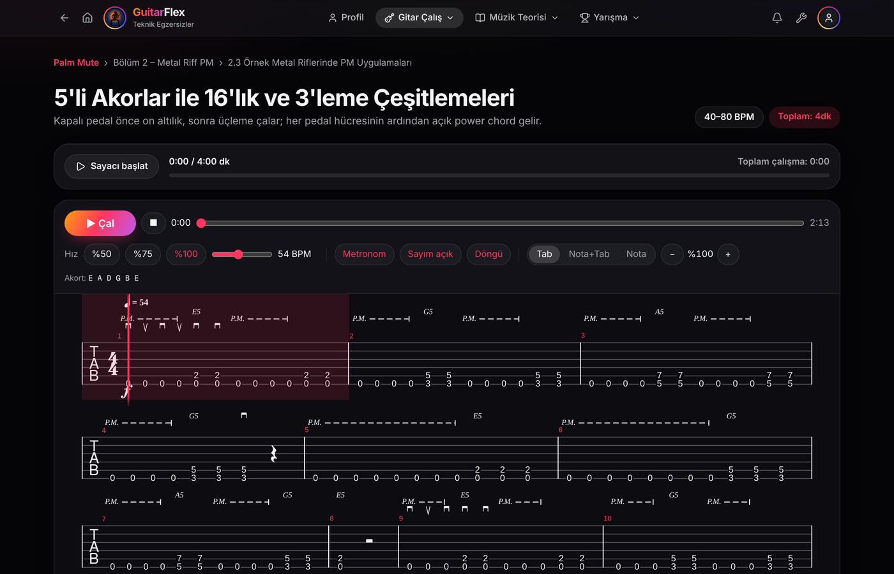 |
| **Quick Study: dinle, incele, eşlikle çal** | **Transkripsiyon: duyduğunu sapta işaretle** |
| 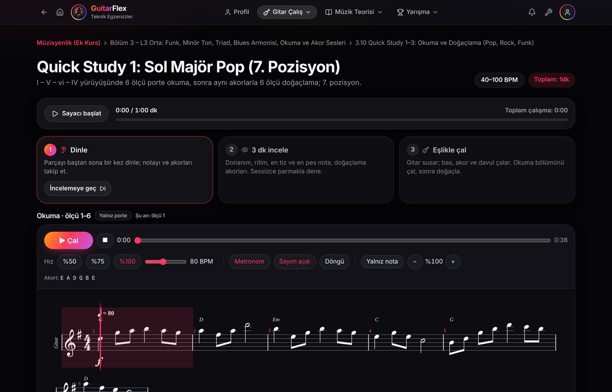 | 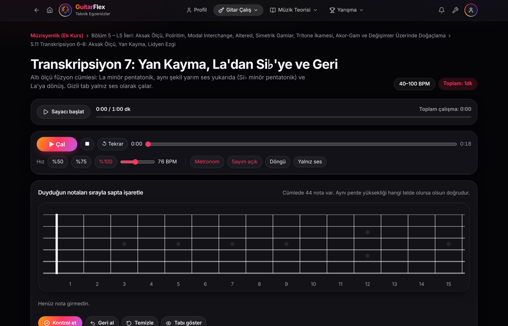 |
| **Şarkı Kütüphanesi** | **Şarkı sayfası: mikser** |
| 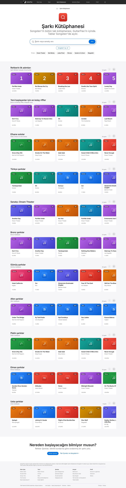 | 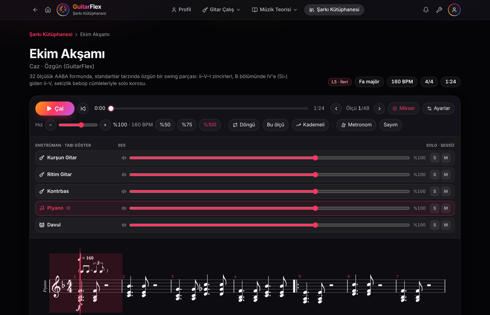 |
| **Kurs kataloğu** | **Ders listesi çekmecesi** |
| 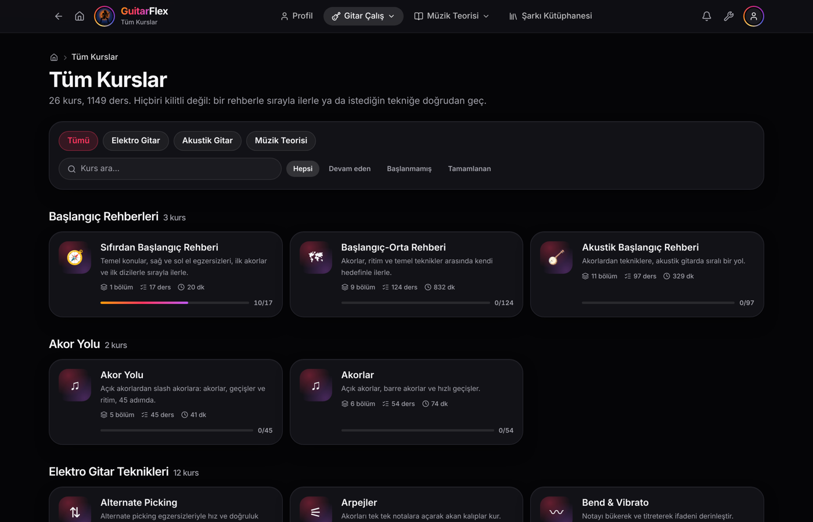 | 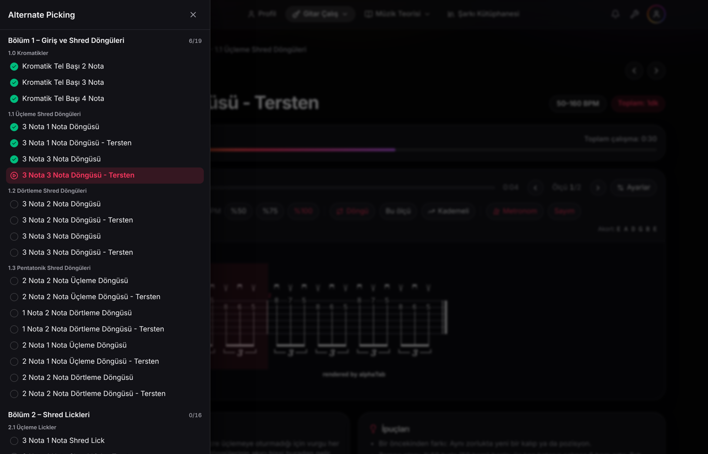 |

## Highlights

- **12 complete technique courses, 557 original exercises** — Alternate Picking, Legato, Sweep Picking, Tapping, Economy Picking, Bend & Vibrato, Slide, Palm Mute, Arpeggios, Chords, Rhythm & Strumming and Chromatic Warm-ups, each split into 3–6 sections that progress from easy to hard
- **Music theory on every lesson** — scale formulas, intervals, chord construction, progressions and rhythm explained next to the tab
- **Generated, verified tabs** — scale fingerings, arpeggio shapes, sequences, legato slurs and pick-stroke directions (alternate, sweep, economy) are computed from pitch data and placed on the strings and fret ranges of a lesson plan, from open position to the 24th fret; an automated checker validates every bar's length, every hammer-on, pull-off and slide, chord tones and scale membership
- **Multi-track tab player** — Guitar Pro / MusicXML / alphaTex playback with per-track mute, solo and volume, an always-visible master volume and mute, separate metronome and count-in levels, speed control, count-in, click-to-seek and drag-to-loop; an end-to-end test plays all 1,521 tab pages and checks that sound actually comes out
- **Level Path** — every electric-guitar chapter is tagged with a level (L1–L5), a skill axis and skills; five level pages gather them across all courses by axis (technique, fretboard, rhythm, theory/ear), ordered by skill prerequisites, with per-axis progress and the level completion goal
- **Theory practice paths** — Rhythm (70 steps), Fretboard Visualization (94), Ear Training (74), Harmony (23) and Reading (40): new questions on every attempt — notes, octaves, pentatonic, CAGED, 3NPS, triad inversion and drop 2 shapes on a clickable fretboard, chord diagrams, interval/chord/scale/progression recognition and melody/chord-root playback with synthesized guitar sound, secondary dominants, ii–V–I and chord-scale questions, staff, rhythm and chord-chart reading rendered in SMuFL notation, and rhythm tap-back scoring
- **Harmony course** — 5 sections, 10 chapters with reading cards, generated practice quizzes (correctly spelled scales, triads, modes, diatonic and seventh chords) and playable example tabs
- **Songs & solos** — a song guide (38 ordered steps tied to course sections) and a library of 99 songs with medal levels, origin/type filters and sorting, linked to Songsterr
- **Improvisation** — 56 backing tracks (drums, bass, rhythm guitar) in six genres, chords spelled from scale degrees, each with compatible scales on an interactive fretboard
- **Game layer** — daily tasks, task-based streaks with streak shields, per-lesson medal tiers, 68 achievements with rarity and XP
- **Desktop app with one-click updates** — the launcher pulls new versions, rebuilds when needed and opens the app
- **Modern UI** — apple.com-inspired design: space-gray frosted header and mega menus, black / #F5F5F7 / white bands with a subtle navy–blue accent on buttons and links, pill buttons, one consistent family of original technique icons, light and dark mode following the system
- **Brand identity** — app icon and home-page cover made from my own pencil drawing, blended into the background without a frame

**Tech stack:** Next.js 16 (App Router) · React 19 · TypeScript · Tailwind CSS 4 · alphaTab (tab rendering & MIDI playback) · Electron · Web Audio API

---

## Türkçe

Kolaydan zora gitar teknikleri, her derste müzik teorisi, şarkı kütüphanesi, doğaçlama eşlikleri ve çalışma takibi sunan bir gitar akademisi.
Masaüstü uygulaması ve web sitesi aynı koddan çalışır.

### Özellikler

- **12 teknik kursu, 557 özgün ders**: Bölüm → alt bölüm (1.0, 1.1 …) → ders yapısı. Her dersin tabı, BPM'i ve hedef süresi var; süre dolunca ders tamamlanır.
- **Müzik Bilgisi**: Her derste gam, aralık, akor ve ritim açıklaması; tab ile aynı veriden üretildiği için nota adları her zaman tabla uyuşur.
- **Başlangıç rehberleri**: Sıfırdan başlayanlar ve başlangıç–orta seviye için kurslardan seçilmiş çalışma yolları; tablı derslerin arasında okuma adımları.
- **Elektro ve akustik**: Teknik kursları ve şarkılar elektro ve akustik gitar için ayrı sayfalarda; seviyeye göre çalışma yolu seçici.
- **Şarkı ve Sololar**: Şarkı Rehberi (teknik bölümlerine bağlı 38 adım), Tüm Şarkılar (madalya seviyesi, köken, tür, arama ve sıralama), Tabla Keşfet (çok kanallı tab oynatıcı) ve Doğaçlama Çal (6 türde 56 eşlik kaydı ve önerilen gamlar).
- **Tab oynatıcı**: Guitar Pro, MusicXML ve alphaTex; her zaman görünen ana ses kaydırıcısı ve sessiz düğmesi, metronom ve sayım için ayrı ses seviyesi, enstrüman bazında ses/mute/solo, hız, metronom, sayım, döngü, nota görünümü. Ses bankası yüklenirken yüzde gösterilir, yüklenemezse yedeğe geçer ya da "Yeniden dene" çıkar.
- **Müzik teorisi**: Ritim (70 adım), Klavye Görselleştirme (94 adım: triad çevrimleri ve drop 2 dahil), Kulak Eğitimi (74 adım: kulaktan melodi ve akor kökü geri çalma dahil) ve Armoni Pratikleri (23 adım: ikincil dominant, ii–V–I, akor-gam dahil) yolları; her denemede yeni sorular. Armoni (Müzik Teorisi Dersleri): 5 bölüm, Eğitim / Pratik / Ek İnceleme kartları. Ayrıca 10 ders ve interaktif sap gezgini.
- **Okuma yolu**: Porteden nota bulma (açık pozisyondan 5. ve 7. pozisyona, donanım ve arızalarla), ritim okuma (dörtlükten onaltılık senkopa) ve akor şeması (slash, slash akor, tekrar, 1./2. son, D.S. al Fine, D.S. al Coda); 7 bölüm, 40 adım. Porte, ritim yazımı ve akor şeması uygulamada çiziliyor; ezgileri sapta sırayla çalarak cevaplıyorsun.
- **Seviye Yolu**: Elektro kursların alt bölümleri beş seviyede (L1 Başlangıç → L5 İleri) toplanır; her seviye teknik, klavye, ritim ve teori/kulak eksenlerine ayrılır, beceri önkoşullarına göre sıralanır, eksen başına ilerleme ve seviye bitirme koşulu (tablı derslerin ve Okuma, Kulak, Ritim yolu adımlarının %70'i) gösterilir. Kurs sayfalarında seviye rozetleri.
- **Müzisyenlik (Ek Kurs)**: Teknik kursların dışında kalan beceriler kısa derslerle: ritim ve porte okuma (porte derslerinde tab gizli, yalnız nota), Doğaçlama Çal eşlikleriyle çalma, senkop ve shuffle, oktavlar, majör gam pozisyonları, pentatonik soru-cevap, dinamik ve ton; ileri seviyelerde funk, triad çevrimleri, drop 2/drop 3, ii–V–I ve kılavuz sesler, aksak ölçü, poliritim, altered, tritone ikamesi, akor-gam ve değişimler üzerinde doğaçlama (L1–L5, 148 ders). Seviye Yolu'nda her seviyenin Ek kurs listesinde.
- **Stiller (Ek Kurs)**: Sekiz stilin dili kısa derslerle, seviyelere göre: blues (shuffle comping, turnaround, kutu lickleri) ve rock riffleri (L2), funk (chank, staccato, tek nota, 9'lu akorlar) ve metal (gallop, 16'lık PM, Drop D) (L3), caz comping (shell, drop 2 ile ii–V–I, akor-melodi) ve bossa nova (L4), bebop dili ve füzyon (yan kayma, pentatonik bindirme, sabit yapılar) (L5); 36 ders. Shuffle ve swing derslerinde sekizlikler uzun-kısa çalınır, Drop D derslerinde oynatıcı akortu gösterir; her derste ton önerisi ve uygun eşlik. Seviye Yolu'nda her seviyenin Stil kursu listesinde.
- **Profil**: Günlük görevler (Egzersiz, Teori, Serbest Çalışma), seri ve seri kalkanı, ders madalyaları (Bronz I → Elmas IV), 68 başarım ve XP, kurs ilerlemesi.
- **Araçlar**: Metronom ve nota bulma testi.

### Son güncellemeler

- **Teknik Egzersizler menüde**: Gitar Çalış menüsünde Elektro Gitar başlığının altında "Teknik Egzersizler" bağlantısı var; 12 elektro tekniğin listelendiği sayfayı açıyor. Akorlar ve Günlük Rutin aynı başlığın altında
- **Rig'im tam katalog, sahnede kullanılmış görünüm**: tarihin en ünlü ekipmanlarından esinlenen 20 kafa amfi ve her birinin eşleşen kabini, 97 pedal (5 kompresör, 10 overdrive, 10 distortion, 10 delay, 10 reverb, 5 chorus, 5 flanger, diğer her türden 3'er). Her çizim özgün: gövde oranı, panel yeri, renk ve düğme sırası gerçeğine yakın, logo ve marka yazısı yok, üzerinde GuitarFlex adı; bilgi satırında "Esinlendiği: …" ve yıl. Hepsi yıllarca sahnede kullanılmış gibi: yırtık tolex köşeleri, solmuş ızgara, kararmış panel, boyası kalkmış pedallar, paslı vidalar; hasar her modelde farklı. Büyük panel yalnız cihazı gösteriyor (düğme ayarı yok), amfi seçince eşleşen kabin öneriliyor, kitaplıkta pedal türü süzgeci var ve "jcm800" gibi gerçek adla arama yapılabiliyor
- **Egzersizler GuitarBear uzunluğunda, bölüm sınavları**: 12 elektro teknik kursta (418 ders) her ders GuitarBear'deki uzunluğunda, A′/B/C ek kısımları kalktı; ders sayfasında kısım düğmeleri yalnız çok kısımlı derste çıkıyor. Bir derste ikili ve üçlü bölünüş karışmıyor (11 derste 32 ölçü düzeltildi). Ders temposu 40–150 BPM arasında seçiliyor, −/+ ve ↑/↓ 5 BPM adımlı. Her bölümün sonunda bir sınav (toplam 58): bölümün derslerinden derlenmiş 4–8 ölçülük parça ve GuitarBear kademeleri (Altın, Platin, Elmas, Usta) arasından seçilen sınav temposu. İlerleme ve defter kayıtları aynen korunuyor
- **Elektro odaklı katalog, yeni Akorlar, Günlük Rutin**: akustik kurslar, başlangıç rehberleri ve Akor Yolu katalogdan, menülerden ve Seviye Yolu'ndan kalktı (ilerleme kayıtları silinmedi). **Akorlar** kısa bir kurs oldu: akor nasıl oluşur, CAGED'in beş şekli, tel gruplarında üçlüler, pozisyon geçişi; derslerde akor şekli kutuları. **Kromatik Isınma** her türden ısınma içeriyor: sol el permütasyonları ve örümcekler, sağ el hız merdiveni, tel atlama, economy, sweep, hybrid, legato, tapping, bend, vibrato ve müzikal sekanslar. **Günlük Rutin**: her biri en fazla 15 dakikalık üç rutin (A Sol El ve İfade, B Sağ El ve Hız, C Koordinasyon ve Ritim) günlere göre sırayla dönüyor; hepsi metronomlu, süre dolunca sıradaki blok kendiliğinden çalıyor. **Günlük hedef**: 10 dk ısınma, günün üç tekniğinden en az ikisi (her biri 5 dk) ve 1 şarkı
- **Rig'im gerçekçi çizimler ve GuitarFlex kataloğu**: bütün ekipman fotoğraf gibi duran özgün çizimler: tolex ve ızgara kumaşı dokusu, fırçalanmış metal ve altın paneller, krom düğmeler, pilot lambası, ayak anahtarı, hoparlör konisi, VU göstergeleri. Katalogda 61 model, hepsi "GuitarFlex" adıyla: 10 amfi, 6 kabin (3 hoparlör türü seçilir), 26 pedal, 7 rack, gitarlar, DI, ses kartı ve yazılım. Büyük panel spot ışıklı bir sahnede açılıyor. Kendi ekipmanının fotoğrafını yükleyince arka plan temizlenip otomatik kırpılıyor. Mikrofonlar katalogdan kalktı; kayıtlı riglerde varsa açılırken çıkarılıyor
- **Teori sadeleşti, hiçbir bilgi çıkmadı**: Teori sayfası beş girişte: Teori Dersleri, Armoni, Nota Okuma, Pratik (Ritim, Klavye Görselleştirme, Kulak Eğitimi) ve Sap Gezgini. **Teori Dersleri**: 49 ders, 5 seviyede başlangıçtan ileriye tek sırada; her dersin sonunda "Önce / Sonra". **Armoni**: tek sayfa, 8 ünite; her ünitede A4 dersler, sapta çalma ve yalnız armoni ve teoriden sorulan ünite sınavı (ikincil dominantlar, ii–V–I, gerilimler, minör gam aileleri, ödünç akorlar, akor-gam yeni). **Nota Okuma**: nota adlarından ileri okumaya 11 konu, 63 adım. **Modlar**: 6 sayfalık ayrıntılı ders (göreceli ve paralel bakış, parlaklık sırası, karakter notası, vamp, örnek şarkı adları, sap pozisyonları, Türk makamlarıyla yaklaşık eşleme). **Sap Gezgini** kendi sayfasında: yedi mod, pentatonik ve blues kutuları, armonik ve melodik minör modları, simetrik gamlar ve akorlar 17 kökte; nota, derece ya da Do-Re-Mi etiketiyle, 3 nota/tel kalıpları ve "Gamı dinle". Eski ilerleme kayıtları yeni yerlere otomatik taşınıyor
- **Sade menüler, işaretle çalışan defter, Şarkılarım, ayrı ses kanalları**: Şarkılarla Öğren, Şarkı Kütüphanesi'nin içine taşındı (Kütüphane, Rehber Şarkılar, Tüm Şarkılar sekmeleri); menülerde aynı sayfaya giden bağlantılar teke indi. Bir egzersize ya da sayfaya geçince sayfa en üstten açılıyor; kurs sayfası bütün bölümleri gösteriyor ve kenar çubuğundaki bölüme tıklayınca oraya kayıyor. Çalışma Defteri artık yalnız senin işaretlediklerini tutuyor: yeşil "Öğrendim", turuncu "Öğreniyorum", "Takvime al" (gün seçici) ve "Listeye ekle"; defter tıklanınca dersi ya da şarkıyı açan bir tablo. Profil › Şarkılarım: Bildiğim şarkılar (intro, riff, 1. solo, 2. solo, outro gibi kısımlarla), Çalıştığım şarkılar, Çalışma listem. Tüm Şarkılar'da her şarkıya özgün çizilmiş kapak. Oynatıcıda Müzik, Metronom ve Sayım ayrı kanallar; müziği kısınca metronom susmuyor, her kanal %450'ye kadar açılıyor ve bozulmasın diye çıkışta sınırlayıcı var
- **Rig'im**: gitarını, pedallarını, amfini, kabinini ve rack efektlerini sürükle-bırak ile sinyal zincirine diz (seri, A/B paralel yol, amfi FX loop). Bütün ekipman çizimleri özgün; kendi ekipmanını adıyla ve fotoğrafıyla ekle, birden çok rig kaydet, JSON ya da PNG olarak dışa aktar. Yalnız görsel; ses işlenmez
- **Songsterr penceresi açılır pencereleri engelliyor**: Songsterr sayfasındaki reklam ve izleme betiklerinin açtığı pencereler önceden varsayılan tarayıcıya gönderiliyor, Chrome'da onlarca sekme açılıyordu. Artık engelleniyor (tarayıcıların açılır pencere engelleyicisi gibi); "Google ile giriş" uygulama içinde küçük bir pencerede açılıyor
- **Çalışma Defteri ve takvim**: yeni sekme. Çaldığın egzersiz ve parçalar kendiliğinden kaydediliyor (kısım, son ölçü, hız, gerçekten çalınan süre, gitar); ders sayfasında "Kaldığın yer: B kısmı, 13. ölçü, %80" ve oradan devam. Sarı "Devam ediyorum" ve yeşil "Öğrendim" düğmeleri ders sayfalarında, şarkı kartlarında ve defterde. Songsterr'de açılan şarkılar deftere düşüyor, süre +5/+10/+15 dk ile eklenir. Gitar listesi, gitar başına süre, filtreler, notlar, JSON dışa/içe aktarma. Ay takviminde çalıştığın günler süreye göre renkli; güne tıklayınca o günün oturumları; haftalık hedef dakika ve plan notları
- **Kapak ve güncelleme düzeltmeleri**: ana sayfa kapağı simsiyah yerine uzay grisinden aşağıdaki beyaz banda yumuşak geçiyor; başlıklar "Gitarı adım adım öğren." ve "İstediğin teknikten başla." Güncelleme masaüstü dosyalarını değiştirince uygulama kendini yeniden başlatıyor (önceden Şarkı Kütüphanesi kartları yeniden açana kadar yanıt vermiyordu); Songsterr penceresi açılamazsa bağlantı yine de açılıyor
- **Yeni görünüm: açık, renkli, sade**: apple.com düzeninde ana sayfa (beyaz, açık gri, uzay grisi ve siyah bantlar), varsayılan açık tema (Profil › Görünüm ve Görünüm › Tema menüsünden Koyu ya da Sistem seçilebilir), Inter yazı tipi (çevrimdışı). Her kurs kendi renginde, iPhone simgesi tarzında özgün simgeyle; kartlar renkli şerit ve ilerleme halkasıyla. "Öne çıkan kurslar" kalktı. **Şarkı Kütüphanesi**: Songsterr tarzı büyük arama kutusu; arama ve şarkı kartları Songsterr'in bütün kütüphanesini GuitarFlex içinde ayrı bir pencerede açıyor; altında Fender Play tarzı yatay şarkı bantları (rehberin ilk adımları, en kolay riffler, efsane sololar, Türkçe şarkılar, madalyalar). **Şarkılarla Öğren**: GuitarBear Şarkı Rehberi'nin 38 adımı aynı sırayla büyük kartlarla. Bizim çalınabilir parçalarımız ve kendi dosyaların Araçlar › Tab Oynatıcı ve Dosyalarım'da. Stiller ek kursu katalogda Orta–İleri grubunda
- **Teori dersleri ders kitabı sayfası**: 10 Müzik Teorisi dersi ve teori yollarının 25 modül dersi, her biri tek A4 sayfasına sığan düzende: tanım, kural/formül tablosu, sap ve akor şemaları, beşliler çemberi, ritim ağacı, tab şeridi, kulakla dinleme, "hemen dene" alıştırmaları, sık hatalar ve kaynaklar. Ders uygulamada da tek bir A4 yaprağı olarak açılıyor ("Genişlik" / "Sayfaya sığdır"); ekranda görünen ile PDF aynı. Her derste "Yazdır / PDF" düğmesi; notalar, aralıklar ve akor şekilleri bağımsız bir betikle doğrulanıyor (4007 denetim)
- **Teori yolları GuitarBear yapısında**: Ritim (9 bölüm, 70 adım), Klavye Görselleştirme (11/84), Kulak Eğitimi (9/60) ve Armoni (5 bölüm, 11 pratik) bölüm, adım, seviye, soru sayısı ve geçme eşiğiyle GuitarBear'deki sırada; soru türleri buna göre ayarlandı (ritimde yazım seçme + metronomla geri vurma, klavyede adlandırma/bulma). GuitarFlex'e özgü bölümler (Triad Çevrimleri, Drop 2, Melodi ve Akor Kökü Geri Çalma, İkincil Dominantlar, ii–V–I, Akor-Gam Eşleme) aynı sayfada ayrı "Ek bölümler" alanında; eski ilerleme kayıtları yeni kodlara otomatik taşınıyor
- **Teori yollarında kilit kalktı**: Ritim, Klavye, Kulak, Armoni ve Okuma yollarındaki bütün adımlar her zaman açık; sıra yalnız öneri. GuitarBear'den gelen derslerin ilk kısımlarındaki birkaç açık hata (başka tele geçen bağ, sol ele çok yakın tap, tap'e bağla varan hammer-on) düzeltildi
- **Songsterr'de ara**: Şarkı Kütüphanesi'nde ve Popüler Şarkılar'da aradığın şarkı burada yoksa, aramanın altında "Songsterr'de ara" çıkıyor ve Songsterr'in bütün tab kataloğunu tarayıcıda açıyor; eşleşen popüler şarkılar da bağlantı olarak listeleniyor. Popüler Şarkılar'a Songsterr'de en çok açılan 28 şarkı daha eklendi (tablar Songsterr'de açılır). Koyu modda açılır listelerdeki grup başlıkları (Gamlar, Akorlar) artık okunuyor
- **Masaüstü simgesi her yerde yeni çizim**: güncelleme simgeyi değiştirince pencere simgesi ve açılış ekranı hemen yenileniyor; Windows'taki masaüstü ve Başlat menüsü kısayolları da simge önbelleğine takılmadan yeni çizime geçiyor
- **Songsterr benzeri kompakt tab ekranı**: bütün kontroller tek ince çubukta: Çal, başa dön, konum, ölçü, hız, döngü, metronom, sayım, kısım (Tümü/A/A′/B/C), ana ses, mikser ve ayarlar. Çubuk sayfa kayınca üstte kalıyor. Seyrek ayarlar (akort, görünüm, metronom ve sayım ses seviyeleri, kademeli hız, sap paneli) açılır panellerde. Tab kendi kutusunda değil, sayfa boyunca aşağı uzuyor; çalarken sayfa çalınan satırı takip ediyor. Ders başlığı ve sayaç küçüldü, sap paneli altta kapatılabilir ince şerit
- **Oynatıcıda ses kontrolü ve uçtan uca ses testi**: çalma çubuğunda her zaman görünen hoparlör düğmesi ve %0–150 ana ses kaydırıcısı; ayarlarda metronom ve sayım için ayrı ses seviyesi; mikserdeki ana ses aynı ayarı kullanıyor ve kalıcı. Ses bankası indirilirken yüzde gösteriliyor, inen dosya denetleniyor, bozuksa ya da inmezse yedek bankaya geçiliyor; hiç ses yoksa Çal kilitlenmek yerine "Ses yok" ve "Yeniden dene" çıkıyor. Yeni test 1.521 tablı sayfanın hepsini açıp çiziyor, çalıyor ve gerçekten ses çıktığını ölçüyor
- **Teknik kursları GuitarBear dersleriyle birebir**: Strumming (14 ders), Bend & Vibrato (24), Hammer-On & Pull-Off (28), Legato (57), Economy Picking (48), Hybrid Picking (25), Sweep Picking (26), Tapping (28) ve Alternate Picking (123) yeniden yazıldı. Her dersin adı, sırası ve ilk kısmı GuitarBear'deki dersin aynısı; ardından o kalıptan türetilen çeşitleme, uygulama ve birleştirme kısımları geliyor. Dersler 16–40 ölçü (eskiden 2–20); tempo eski dersten düşük değil. Palm Mute, Arpej ve Slide da aynı kurala geçti
- **Şarkı Kütüphanesi'ne dosyadan şarkı ekleme**: kendi Guitar Pro, MusicXML ya da Capella dosyanı ekle, bilgisayarda saklansın; 128 enstrüman üflemeli, yaylı, vurmalı gibi ailelere ayrılıyor; şarkı başına mikser ayarı kalıcı. Kütüphane 16 şarkıya çıktı (Sarı Dolmuş tarzı, Kordon Ska, Pachelbel Kanonu, Portakal Bahçesi eklendi)
- **Küçük metronom penceresi**: Metronom sekmesindeki düğmeyle açılan, başka uygulamalar kullanılırken de ekranın en üstünde kalan küçük pencere
- **Yeni marka ve renkler**: uygulama simgesi ve ana sayfa kapağı benim karakalem çizimim; logo çerçevesiz, kapak arka plana yumuşakça karışıyor. Siyah–uzay grisi–beyaza apple.com'daki gibi hafif lacivert–mavi vurgu (düğmeler, bağlantılar) eklendi. Teknik simgeleri tek tarzda yeniden çizildi: 26 özgün simge, üç renk ailesi
- **Slide kursu yeni egzersiz standardıyla yeniden yazıldı**: 16 özgün çalışma, 19–30 ölçü (eskiden 4–12); bağlı slide, yeniden penalı slide, notaya alttan/üstten giriş ve notadan çıkış; her derste kalıp, çeşitleme, uygulama ve birleştirme kısımları
- **Yeni simge: yüzsüz siluet gitarist**: çizgi film oranlarında, öne eğilip solo atan, dizleri kırık beyaz siluet; tek kesikli gri gitar, siyah–uzay grisi zemin. Küçük boyutlar (16–48 px) için sadeleştirilmiş ayrı çizim; kapak görseli de yeni figürle
- **Arpej kursu yeni egzersiz standardıyla yeniden yazıldı**: 12 özgün çalışma, 16–25 ölçü (eskiden 6–10); her birinde kalıp, çeşitleme, uygulama ve birleştirme kısımları; ritim, tel grubu, armoni ve yön çeşitlemeleri; akor adları, pena yönleri ve parmaklar tabın üstünde
- **apple.com ölçüleriyle siyah–uzay grisi–beyaz tasarım**: 48 px buzlu koyu üst çubuk ve mega menü, ana sayfada 692 px'lik siyah ve açık gri tanıtım bantları (56 px başlık), 2 sütunlu 580 px döşemeler, hap düğmeler (açık zeminde siyah, koyu zeminde beyaz), "›" bağlantılar, açık gri site haritalı alt bilgi. Lacivert kalktı; yalnız beyaz, #F5F5F7, uzay grisi ve siyah. Simge ve kapak da siyah–uzay grisi zemine geçti
- **Yeni görünüm: apple.com'dan ilhamla sade tasarım**: uzay grisi buzlu üst çubuk ve tam genişlikte açılan sütunlu menüler (klavyeyle gezilebilir), dev başlıklı sayfa başları, beyaz ve açık gri bantlar, lacivert vurgu ve hap düğmeler, uzay grisi yazı rengi, her sayfada site haritalı alt bilgi. Ana sayfa üst üste tanıtım bantlarından oluşuyor: kaldığın yerden devam, Seviye Yolu, Şarkı Kütüphanesi, teori yolları ve kategori döşemeleri. Açık ve koyu mod bilgisayarın ayarını izliyor; bütün yazı/zemin çiftleri WCAG AA kontrastında. Gradyanlar ve süsler kaldırıldı
- **CAGED Sistemi tablosu** (Teori › Klavye Görselleştirme › CAGED Sistemi): beş majör (C, A, G, E, D) ve beş minör açık akor şekli, her biri 2 perde yukarı taşınmış hâliyle yan yana (C→D, A→B, G→A, E→G, D→E; Cm→Dm, Am→Bm, Gm→Am, Em→Gm, Dm→Em); parmak numaraları, barre, vurgulu kök notalar ve perde/parmak/kök teli özet tablosu
- **Yeni simge ve kapak görseli**: lacivert zemin üzerinde tek kesikli elektro gitar çalan özgün gitarist figürü; masaüstü kısayolu, pencere, site simgesi ve açılış ekranı yenilendi. Marka sayfasında kapak, simge boyutları ve renk paleti (siyah, uzay grisi, beyaz)
- **Yeni site düzeni**: ana sayfada kaldığın yerden devam, günlük görevler ve seri, kategori kartları, devam ettiğin kurslar, öne çıkanlar ve kütüphaneden parçalar. Yeni Kurs Kataloğu (gruplara, duruma ve ada göre süzme; her kartta bölüm, ders, süre ve ilerleme). Kurs sayfasında kurs seçici, ilerleme şeridi, mevcut bölüm ve Devam et düğmesi, sıradaki ders vurgusu. Ders sayfasında kırıntı, bütün kursu gösteren ders listesi çekmecesi, önceki/sonraki ders (Alt + ←/→). Telefonda hamburger menü ve yapışkan bölüm çubuğu. Eski ana sayfa artık Elektro Gitar sayfası. Hiçbir içerik kilitli değil: kurs bölümlerindeki ve Şarkı Rehberi'ndeki kilitler kalktı. Tabda akor adı, parmak numarası ve kısım yazıları üst üste binmiyor; mikserde bas ve klavye için ayrı simgeler
- **Şarkı Kütüphanesi** (yeni sekme, Yarışma'nın yerine): kurşun gitar, ritim gitar, bas ve davullu 12 çok enstrümanlı şarkı; pop, klasik, reggae, blues, fingerstyle, country, rock, funk, Türk halk müziği tarzı, bossa nova, metal ve caz, L1'den L5'e. Hepsi GuitarFlex'in özgün parçası ya da kamu malı ezgilerin (Neşe Marşı, Greensleeves) kendi düzenlemesi. Arama, tür, zorluk, ton, tempo ve enstrüman filtreleri; liste ya da kart görünümü. Şarkı sayfasında mikserli oynatıcı, form ve kısımlar, akorlar, teknikler ve çalışma ipuçları. Piyano, org ve yaylılar notayla gösteriliyor
- **Yarışma bölümü kaldırıldı**
- **Yeni tab oynatıcı**: ilerleme çubuğunda tıkla-git ve kısım sınırları, ölçü sayacı, hız %25–150, ölçü ya da seçili aralık döngüsü (taba sürükle ya da Shift+tık), kısım düğmeleri (A, A′, B, C) ile tek tıkla kısım döngüsü, kademeli hızlanma (her turda hız artar), metronom her vuruş ya da yalnız ölçü başı, sayım. Ayarlar panelinde Tab / Nota+Tab / Nota, sayfa ya da yatay yerleşim, yakınlaştırma, imleç takibi, çalan notaları gösteren sap paneli ve klavye kısayolları (boşluk, ←/→, L, ↑/↓, M). Çok enstrümanlı tablarda mikser: ses, solo, sessiz, tabı gösterilen enstrüman. Tabın altında ritim (sap, kiriş, üçleme) görünüyor; akor adları pena ve parmak işaretleriyle çakışmıyor. Yeni ses bankası GeneralUser GS (temiz, overdrive, distortion gitar sesi dersin ton bilgisinden seçiliyor; hafif Sonivox seçeneği duruyor)
- **Stiller kursu yeni egzersiz standardıyla yeniden yazıldı**: 36 çalışma, her biri 20–36 ölçü; blues üç koro (36 ölçü), funk ve metal 24 ölçü. Her egzersizde kalıp, çeşitleme, uygulama ve birleştirme kısımları; kısım adları tabın üstünde. Örnekler: La'da shuffle eşliği, Fa'da caz blues dörtlükleri, ii–V–I üzerinde bebop gamları, sabit yapılı füzyon akorları. Ders süresi artık parçanın gerçek uzunluğuna göre (1–3 dakika)
- **Yeni ders türleri: Quick Study, transkripsiyon, kompozisyon**: Müzisyenlik ek kursuna 31 ders. Quick Study'de 12 ölçülük parça üç adımda çalışılıyor: dinle, 3 dakika incele, eşlikle çal (6 ölçü okuma + 6 ölçü doğaçlama). Transkripsiyonda tab gizli, yalnız ses çalıyor; duyduğun notaları sapta işaretleyip kontrol ediyorsun. Kompozisyonda akor yürüyüşü ve kurallarla kendi 8 ölçünü yazıyorsun; geri bildirim notaları akora göre adlandırıyor (F üstünde Si♭, A# değil). Melodik cümle dersleri 24 ölçüye çıktı (motif, çeşitleme, uygulama, birleştirme)
- **Palm Mute kursu yeniden yazıldı (yeni egzersiz standardının ilk kursu)**: 17 özgün çalışma, her biri 20–30 ölçü (eskiden 8–12). Her egzersiz dört kısımdan oluşuyor: temel kalıp, çeşitleme, uygulama (riff ve power chord yürüyüşleri) ve birleştirme; on altılık ile üçleme hücreleri, sus ve aksan çeşitleri, pozisyon değişimi. Ders metninde "Bu çalışmada", kısım rehberi, odak döngüsü ve tempo planı var. Rehberlerdeki Palm Mute dersleri olduğu gibi kaldı
- **Stiller ek kursu**: blues, rock, funk, metal, caz comping, bossa nova, bebop ve füzyon (36 ders)
- **Okuma yolu ve yeni yol adımları**: porte ve ritim okuma, akor şeması; kulaktan melodi ve akor kökü; ikincil dominant, ii–V–I, akor-gam; triad çevrimi ve drop 2
- **Müzisyenlik ek kursu L5**: aksak ölçü, poliritim, modal interchange, altered, simetrik gamlar, tritone ikamesi, akor-gam, gerilimli dizilişler, değişimler üzerinde doğaçlama; akor diyagramları koyu temada görünür
- **Müzisyenlik ek kursu L4**: CAGED, harmonik ve melodik minör, drop 2/drop 3, 7'li arpejler, ikincil dominantlar, ii–V–I, kılavuz sesler, gerilimler, armonikler, ritim cümleleri, modal doğaçlama
- **Müzisyenlik ek kursu L3**: funk ve ghost nota, minör ton, harmonik minör, triad çevrimleri, double stop, blues armonisi, nota ve akor şeması okuma, akor sesiyle doğaçlama
- **Müzisyenlik ek kursu (L1–L2)**: ritim ve nota okuma, eşlikle çalma, senkop, shuffle, oktav, majör gam, pentatonik doğaçlama, dinamik
- **Seviye Yolu**: yeni Seviye Yolu sayfası (Gitar Çalış → Elektro Gitar). Beş seviyenin özet kartları ve her seviye için ayrı sayfa: kurslardaki o seviyeye ait alt bölümler teknik, klavye, ritim ve teori/kulak eksenlerine ayrılıyor, önce temel beceriler gelecek şekilde önkoşullara göre sıralanıyor; her satırda kurs, alt bölüm, ders sayısı ve tamamlanan dersler. Üstte eksen başına tablı ders ilerlemesi ve seviyeyi bitirme koşulu (tablı derslerin %70'i). Kilit yok. Kurs sayfalarında alt bölüm başlıklarında L1–L5 rozeti; rozete tıklayınca o seviyenin sayfası açılıyor. Ek kurs, Stil kursu, yol adımları ve seviye etütleri yakında
- **Seviye ve beceri etiketleri**: elektro kursların, Akorlar'ın ve Kromatik Isınma'nın alt bölümleri artık bir seviye (L1–L5), bir ana eksen ve yan eksenler (teknik, klavye, ritim, teori/kulak) ve beceri etiketleri taşıyor. "Tersten" çalınan dersler, kaynak oldukları ileri derse bağlı. Tablar, ders adları ve ders sayıları olduğu gibi kaldı
- **Müfredat altyapısı**: derslere ve alt bölümlere seviye (L1–L5), eksen (teknik, klavye, ritim, teori/kulak) ve beceri etiketleri için veri alanları; etüt, Quick Study, transkripsiyon, kompozisyon ve resital gibi yeni ders türlerinin şeması. Rehberler bir dersi kopyalamak yerine kaynak derse bağlanabiliyor; içerik denetimi yeni alanları da doğruluyor
- **Yeni tasarım: Apple karanlık mod × Instagram gradyanı** — neredeyse siyah zemin, üstte turuncu–pembe–mor ışık; buzlu cam üst çubuk ve menüler; ince kenarlı, hafif yükseltilmiş kartlar; gradyan hap düğmeler; Instagram hikâye halkası gibi ilerleme halkaları ve avatar. Yazı tipi Apple cihazlarda San Francisco, diğerlerinde Inter; başlıklar sıkı harf aralıklı, büyük harf etiketler kalktı. Üst çubuk telefonda sarar
- **Dersler kolaydan zora**: yeni zorluk denetimi (hız, tel geçişi, tel atlama, pozisyon değişimi, teknik yükü) her alt bölümde sıranın bozulmadığını ve kopya ders olmadığını denetliyor; sırayı bozan dersler yeniden yazıldı (alternate picking "Tersten" arpejleri iç geçişle, legato "Tersten" dersleri gerçek ters yönde, economy Pentatonik 2 dönüşlü, akustik bend Mini Lick 4 üç bend türüyle, tapping Egzersiz 3 sekiz notalık kalıpla). Economy Bit 1 5/4 ölçüde ve karışık ritimde, Lick 1 ve oktav kalıpları belgedeki nota değerlerinde, sweep arpejlerinde 2/4 son ölçü; yerleşik Alternatif Pena kursunda iç/dış pena tanımları düzeltildi. Yeni ritim denetimi her dersin ölçü birimini, ölçü sayısını, temposunu ve nota değerlerini belgeyle karşılaştırıyor
- **Egzersizler teori ve teknik açısından elden geçti**: her teknikte hücreler o tekniğin hareketini gerçekten çalıştırıyor — alternate picking'de ileri derslerde dış, "Tersten" derslerde iç tel geçişi; economy'de tel değişimleri süpürmeyle; sweep'te iki telde aşağı-aşağı-yukarı-yukarı, şekil sınırında bağ yok; hybrid'de kalın tellerde parmak yok; tapping'de her vuruşta tap. Cümleler kökte ya da akor sesinde biter, döngüler ortadan kesilmez; modlarda karakteristik ses ve drone notu, bend derslerinde hedef sesler, akustikte kalın tellerde bend yok. Akor dizileri tonikte kapanır, tarama yönü sarkaç kuralına uyar, hava vuruşunda akor çınlamaya devam eder; akor notaları doğru harf adlarıyla yazılır (Gm: Sol – Si♭ – Re)
- **Egzersizler baştan yazıldı**: elektro ve akustik 17 kursun 521 dersi artık sapın doğru bölgesinde — her ders ders planındaki tellerde, perde aralığında, nota değerinde ve ölçü sayısında. Hybrid picking'de triad kalıpları 16. perdeye, 7'li akorlar 20. perdeye kadar, sweep 20., tapping 24. perdeye kadar, palm mute riff'leri kalın Mi, La ve Re telinde, strumming'de 5–9. perdede barre ve ghost vuruşlar, akustik derslerde boş tellerden yedi diyatonik pozisyona. Akor tonları, gam notaları, power chord aralıkları ve pena yönleri üretim sırasında denetleniyor
- **Teori yolları**: Ritim (dinle, yazımı seç, geri vur), Klavye Görselleştirme (sapta tel, nota, oktav, pentatonik, CAGED, 3NPS) ve Kulak Eğitimi (aralık, akor türü, gam, akor yürüyüşü); adımlar sırayla açılır, sonuçlar kaydedilir
- **Armoni**: 5 bölüm, 10 alt bölüm; Eğitim metinleri, her denemede yeni sorularla Pratik kartları (notalar harf adına göre doğru yazılır) ve çalınacak Ek İnceleme tabları
- **Şarkı Rehberi** (38 adım) ve **Tüm Şarkılar** filtreleri: Bronz–Usta seviyeleri, Global/Türkçe, Riff/Solo, arama ve sıralama
- **Doğaçlama Çal**: Rock, Blues, Metal, Pop, Funk ve Groove türlerinde 56 eşlik; akorlar tonun derecelerinden yazılır, akor şekilleri ve gamlar otomatik denetlenir
- **Profil**: günlük görevler, seri ve seri kalkanı, ders madalya kademeleri ve 68 başarım
- Kurs ve rehber derslerinde envanterle eşleşen adlar, bölüm sınavı satırları, ders hedefleri ve süreleri; tabların müzik ve gitar teorisi denetimi genişletildi
- Çalmadan önceki **sayım** ekranda geri sayan rakamla görünüyor; **İptal**, **Hemen başla** ve **Sayımı kapat** düğmeleri var (Esc de iptal eder), sayım tercihi hatırlanıyor
- Üst menü sadeleşti: **Gitar Çalış** altında Akustik (Teknik Egzersizler, Şarkılar) ve Elektro (Teknik Egzersizler, Şarkı ve Sololar) başlıkları; egzersizler bu sayfalarda
- **Geri** ve **Ana sayfa** tuşları; logonun yanındaki başlık bulunulan bölümü gösterir
- **Gitarda Nasıl Çalışmalıyım?**: elektro ve akustik için seviyeye göre çalışma yolu seçici
- Akustik gitar için ayrı egzersiz ve şarkı sayfaları
- Şarkı listesinde her şarkının altında hazırlık kurslarının adları ve kurs filtresi
- Rehberlerde tabsız **okuma adımları** ("Nasıl çalınır?" anlatımları) ve kurs sırasının içerikle birlikte belirlenmesi
- **Şarkı ve Sololar** bölümü: Popüler Şarkılar, Tabla Keşfet ve Doğaçlama Çal
- **12 teknik kursunun tamamı** yeniden yazıldı: 3–6 bölüm, toplam 557 ders; her derste "Müzik Bilgisi" kutusu
- Gam, arpej, sweep, legato ve economy picking parmak düzenleri ile pena yönleri nota verisinden otomatik hesaplanıyor
- Başlangıç rehberleri yeni kurslardan seçilmiş derslerle yeniden kuruldu

### Yol haritası

- **Ton Lab**: ünlü şarkıların gitar tonlarını kişinin kendi ekipmanına (amfi modelleyici, pedal) uyarlama
- Üyelik ve buluta kayıtlı ilerleme
- Haftalık meydan okumalar ve sıralama
