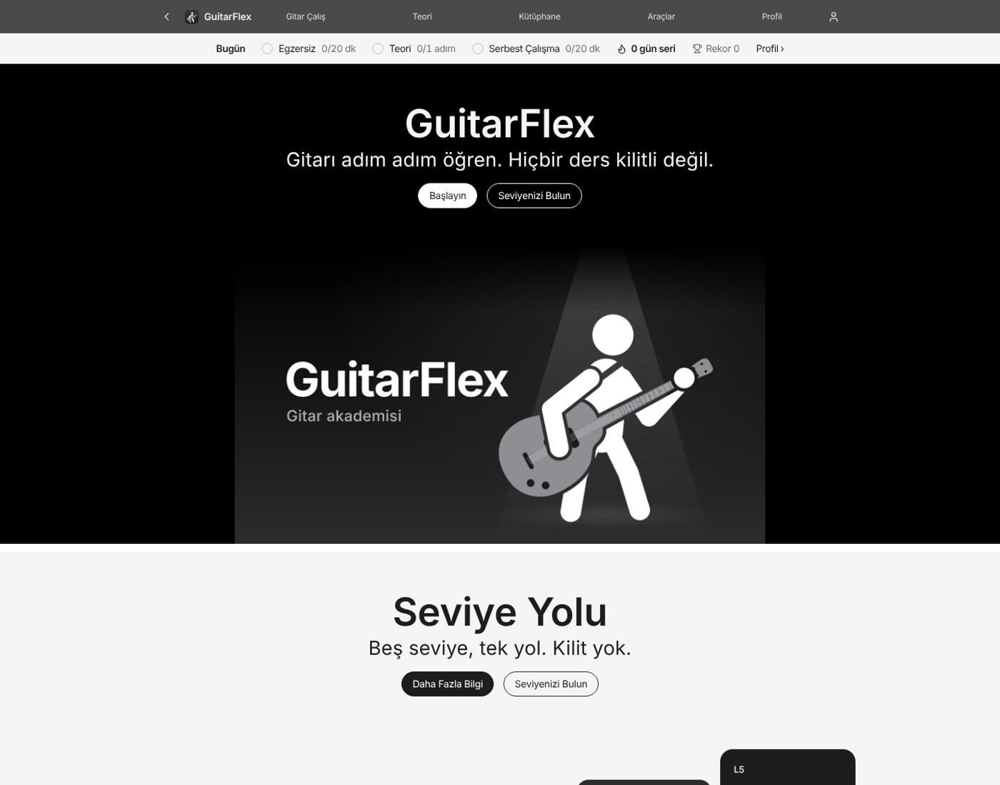
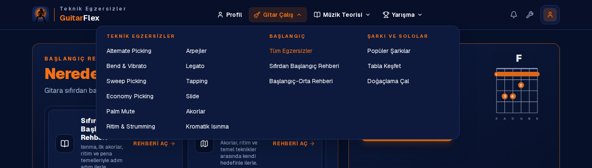
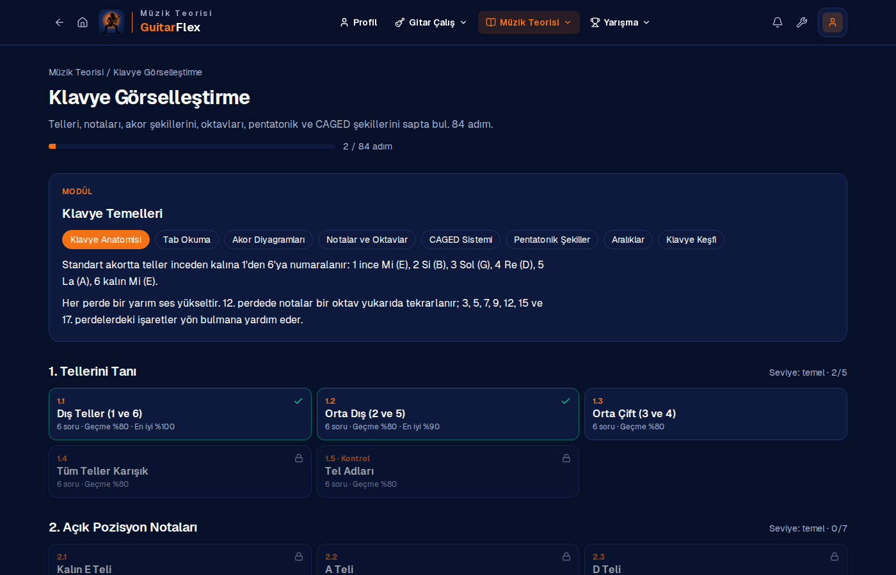
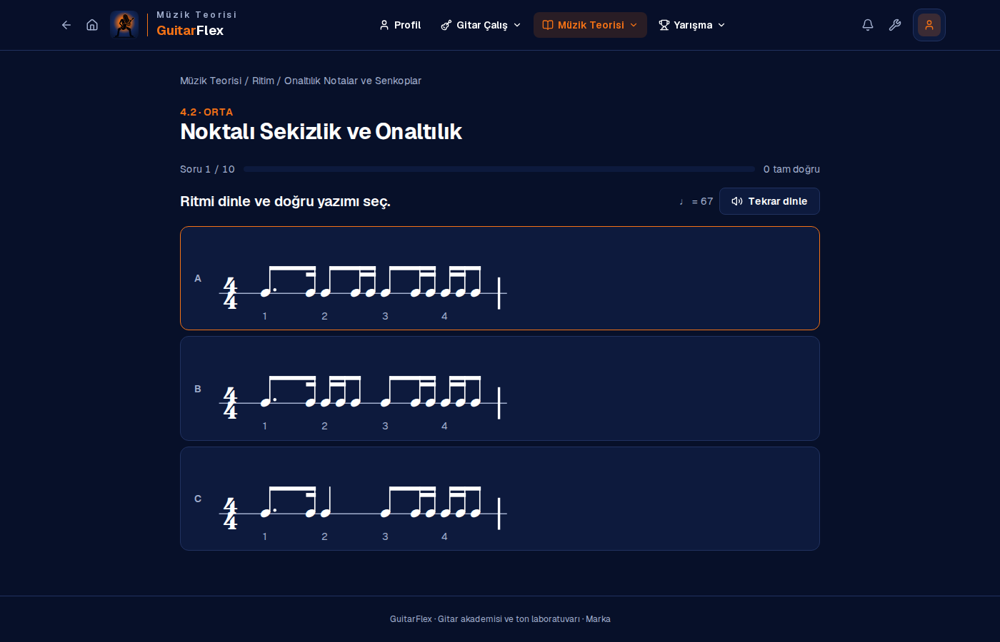
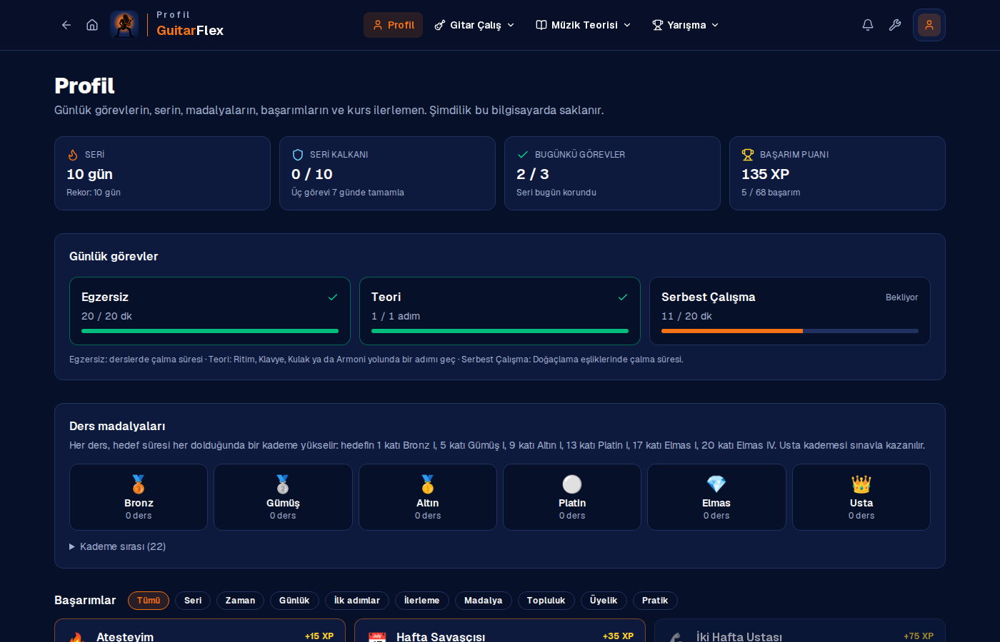
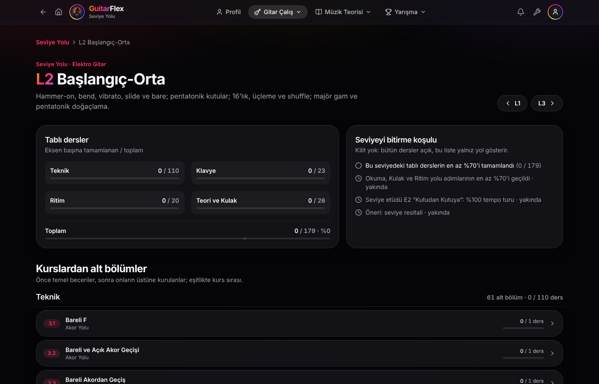

# GuitarFlex — Gitar Akademisi

**GuitarFlex** is a guitar academy I designed and built: a desktop app (Electron) and a website (Next.js) running from a single codebase.
It takes a player from the first chord to neoclassical sweep arpeggios through 12 structured technique courses, explains the music theory
behind every exercise, and adds a songs & solos library, backing tracks for improvisation and a Songsterr-style multi-track tab player.

| Ana sayfa | Menü |
|---|---|
|  |  |
| **Kurs** | **Ders** |
|  |  |
| **Popüler Şarkılar** | **Doğaçlama Çal** |
|  |  |
| **Tab oynatıcı** | **Müzik teorisi** |
|  |  |
| **Klavye Görselleştirme yolu** | **Sapta soru (CAGED)** |
|  |  |
| **Ritim: dinle, seç, vur** | **Armoni dersleri** |
|  |  |
| **Profil: görevler, seri, başarımlar** | **Seviye Yolu** |
|  |  |
| **Seviye sayfası: eksenler ve bitirme koşulu** | |
|  | |

## Highlights

- **12 complete technique courses, 557 original exercises** — Alternate Picking, Legato, Sweep Picking, Tapping, Economy Picking, Bend & Vibrato, Slide, Palm Mute, Arpeggios, Chords, Rhythm & Strumming and Chromatic Warm-ups, each split into 3–6 sections that progress from easy to hard
- **Music theory on every lesson** — scale formulas, intervals, chord construction, progressions and rhythm explained next to the tab
- **Generated, verified tabs** — scale fingerings, arpeggio shapes, sequences, legato slurs and pick-stroke directions (alternate, sweep, economy) are computed from pitch data and placed on the strings and fret ranges of a lesson plan, from open position to the 24th fret; an automated checker validates every bar's length, every hammer-on, pull-off and slide, chord tones and scale membership
- **Multi-track tab player** — Guitar Pro / MusicXML / alphaTex playback with per-track mute, solo and volume, speed control, metronome, count-in, click-to-seek and drag-to-loop
- **Level Path** — every electric-guitar chapter is tagged with a level (L1–L5), a skill axis and skills; five level pages gather them across all courses by axis (technique, fretboard, rhythm, theory/ear), ordered by skill prerequisites, with per-axis progress and the level completion goal
- **Theory practice paths** — Rhythm (70 steps), Fretboard Visualization (94), Ear Training (74), Harmony (23) and Reading (40): new questions on every attempt — notes, octaves, pentatonic, CAGED, 3NPS, triad inversion and drop 2 shapes on a clickable fretboard, chord diagrams, interval/chord/scale/progression recognition and melody/chord-root playback with synthesized guitar sound, secondary dominants, ii–V–I and chord-scale questions, staff, rhythm and chord-chart reading rendered in SMuFL notation, and rhythm tap-back scoring
- **Harmony course** — 5 sections, 10 chapters with reading cards, generated practice quizzes (correctly spelled scales, triads, modes, diatonic and seventh chords) and playable example tabs
- **Songs & solos** — a song guide (38 ordered steps tied to course sections) and a library of 99 songs with medal levels, origin/type filters and sorting, linked to Songsterr
- **Improvisation** — 56 backing tracks (drums, bass, rhythm guitar) in six genres, chords spelled from scale degrees, each with compatible scales on an interactive fretboard
- **Game layer** — daily tasks, task-based streaks with streak shields, per-lesson medal tiers, 68 achievements with rarity and XP
- **Desktop app with one-click updates** — the launcher pulls new versions, rebuilds when needed and opens the app
- **Modern UI** — Apple-style dark mode with an Instagram-like orange → pink → purple gradient: frosted-glass header and menus, hairline cards, pill buttons and segmented controls, story-ring progress indicators; San Francisco on Apple devices, Inter elsewhere
- **Brand identity** — name, gradient wordmark and guitarist-silhouette logo drawn programmatically as SVG

**Tech stack:** Next.js 16 (App Router) · React 19 · TypeScript · Tailwind CSS 4 · alphaTab (tab rendering & MIDI playback) · Electron · Web Audio API

---

## Türkçe

Kolaydan zora gitar teknikleri, her derste müzik teorisi, şarkı kütüphanesi, doğaçlama eşlikleri ve çalışma takibi sunan bir gitar akademisi.
Masaüstü uygulaması ve web sitesi aynı koddan çalışır.

### Özellikler

- **12 teknik kursu, 557 özgün ders**: Bölüm → alt bölüm (1.0, 1.1 …) → ders yapısı. Her dersin tabı, BPM'i ve hedef süresi var; süre dolunca ders tamamlanır.
- **Müzik Bilgisi**: Her derste gam, aralık, akor ve ritim açıklaması; tab ile aynı veriden üretildiği için nota adları her zaman tabla uyuşur.
- **Başlangıç rehberleri**: Sıfırdan başlayanlar ve başlangıç–orta seviye için kurslardan seçilmiş çalışma yolları; tablı derslerin arasında okuma adımları.
- **Elektro ve akustik**: Teknik kursları ve şarkılar elektro ve akustik gitar için ayrı sayfalarda; seviyeye göre çalışma yolu seçici.
- **Şarkı ve Sololar**: Şarkı Rehberi (teknik bölümlerine bağlı 38 adım), Tüm Şarkılar (madalya seviyesi, köken, tür, arama ve sıralama), Tabla Keşfet (çok kanallı tab oynatıcı) ve Doğaçlama Çal (6 türde 56 eşlik kaydı ve önerilen gamlar).
- **Tab oynatıcı**: Guitar Pro, MusicXML ve alphaTex; enstrüman bazında ses/mute/solo, hız, metronom, sayım, döngü, nota görünümü.
- **Müzik teorisi**: Ritim (70 adım), Klavye Görselleştirme (94 adım: triad çevrimleri ve drop 2 dahil), Kulak Eğitimi (74 adım: kulaktan melodi ve akor kökü geri çalma dahil) ve Armoni Pratikleri (23 adım: ikincil dominant, ii–V–I, akor-gam dahil) yolları; her denemede yeni sorular. Armoni (Müzik Teorisi Dersleri): 5 bölüm, Eğitim / Pratik / Ek İnceleme kartları. Ayrıca 10 ders ve interaktif sap gezgini.
- **Okuma yolu**: Porteden nota bulma (açık pozisyondan 5. ve 7. pozisyona, donanım ve arızalarla), ritim okuma (dörtlükten onaltılık senkopa) ve akor şeması (slash, slash akor, tekrar, 1./2. son, D.S. al Fine, D.S. al Coda); 7 bölüm, 40 adım. Porte, ritim yazımı ve akor şeması uygulamada çiziliyor; ezgileri sapta sırayla çalarak cevaplıyorsun.
- **Seviye Yolu**: Elektro kursların alt bölümleri beş seviyede (L1 Başlangıç → L5 İleri) toplanır; her seviye teknik, klavye, ritim ve teori/kulak eksenlerine ayrılır, beceri önkoşullarına göre sıralanır, eksen başına ilerleme ve seviye bitirme koşulu (tablı derslerin ve Okuma, Kulak, Ritim yolu adımlarının %70'i) gösterilir. Kurs sayfalarında seviye rozetleri.
- **Müzisyenlik (Ek Kurs)**: Teknik kursların dışında kalan beceriler kısa derslerle: ritim ve porte okuma (porte derslerinde tab gizli, yalnız nota), Doğaçlama Çal eşlikleriyle çalma, senkop ve shuffle, oktavlar, majör gam pozisyonları, pentatonik soru-cevap, dinamik ve ton; ileri seviyelerde funk, triad çevrimleri, drop 2/drop 3, ii–V–I ve kılavuz sesler, aksak ölçü, poliritim, altered, tritone ikamesi, akor-gam ve değişimler üzerinde doğaçlama (L1–L5, 148 ders). Seviye Yolu'nda her seviyenin Ek kurs listesinde.
- **Profil**: Günlük görevler (Egzersiz, Teori, Serbest Çalışma), seri ve seri kalkanı, ders madalyaları (Bronz I → Elmas IV), 68 başarım ve XP, kurs ilerlemesi.
- **Araçlar**: Metronom ve nota bulma testi.

### Son güncellemeler

- **Okuma yolu ve yeni yol adımları**: porte ve ritim okuma, akor şeması; kulaktan melodi ve akor kökü; ikincil dominant, ii–V–I, akor-gam; triad çevrimi ve drop 2
- **Müzisyenlik ek kursu L5**: aksak ölçü, poliritim, modal interchange, altered, simetrik gamlar, tritone ikamesi, akor-gam, gerilimli dizilişler, değişimler üzerinde doğaçlama; akor diyagramları koyu temada görünür
- **Müzisyenlik ek kursu L4**: CAGED, harmonik ve melodik minör, drop 2/drop 3, 7'li arpejler, ikincil dominantlar, ii–V–I, kılavuz sesler, gerilimler, armonikler, ritim cümleleri, modal doğaçlama
- **Müzisyenlik ek kursu L3**: funk ve ghost nota, minör ton, harmonik minör, triad çevrimleri, double stop, blues armonisi, nota ve akor şeması okuma, akor sesiyle doğaçlama
- **Müzisyenlik ek kursu (L1–L2)**: ritim ve nota okuma, eşlikle çalma, senkop, shuffle, oktav, majör gam, pentatonik doğaçlama, dinamik
- **Seviye Yolu**: yeni Seviye Yolu sayfası (Gitar Çalış → Elektro Gitar). Beş seviyenin özet kartları ve her seviye için ayrı sayfa: kurslardaki o seviyeye ait alt bölümler teknik, klavye, ritim ve teori/kulak eksenlerine ayrılıyor, önce temel beceriler gelecek şekilde önkoşullara göre sıralanıyor; her satırda kurs, alt bölüm, ders sayısı ve tamamlanan dersler. Üstte eksen başına tablı ders ilerlemesi ve seviyeyi bitirme koşulu (tablı derslerin %70'i). Kilit yok. Kurs sayfalarında alt bölüm başlıklarında L1–L5 rozeti; rozete tıklayınca o seviyenin sayfası açılıyor. Ek kurs, Stil kursu, yol adımları ve seviye etütleri yakında
- **Seviye ve beceri etiketleri**: elektro kursların, Akorlar'ın ve Kromatik Isınma'nın alt bölümleri artık bir seviye (L1–L5), bir ana eksen ve yan eksenler (teknik, klavye, ritim, teori/kulak) ve beceri etiketleri taşıyor. "Tersten" çalınan dersler, kaynak oldukları ileri derse bağlı. Tablar, ders adları ve ders sayıları olduğu gibi kaldı
- **Müfredat altyapısı**: derslere ve alt bölümlere seviye (L1–L5), eksen (teknik, klavye, ritim, teori/kulak) ve beceri etiketleri için veri alanları; etüt, Quick Study, transkripsiyon, kompozisyon ve resital gibi yeni ders türlerinin şeması. Rehberler bir dersi kopyalamak yerine kaynak derse bağlanabiliyor; içerik denetimi yeni alanları da doğruluyor
- **Yeni tasarım: Apple karanlık mod × Instagram gradyanı** — neredeyse siyah zemin, üstte turuncu–pembe–mor ışık; buzlu cam üst çubuk ve menüler; ince kenarlı, hafif yükseltilmiş kartlar; gradyan hap düğmeler; Instagram hikâye halkası gibi ilerleme halkaları ve avatar. Yazı tipi Apple cihazlarda San Francisco, diğerlerinde Inter; başlıklar sıkı harf aralıklı, büyük harf etiketler kalktı. Üst çubuk telefonda sarar
- **Dersler kolaydan zora**: yeni zorluk denetimi (hız, tel geçişi, tel atlama, pozisyon değişimi, teknik yükü) her alt bölümde sıranın bozulmadığını ve kopya ders olmadığını denetliyor; sırayı bozan dersler yeniden yazıldı (alternate picking "Tersten" arpejleri iç geçişle, legato "Tersten" dersleri gerçek ters yönde, economy Pentatonik 2 dönüşlü, akustik bend Mini Lick 4 üç bend türüyle, tapping Egzersiz 3 sekiz notalık kalıpla). Economy Bit 1 5/4 ölçüde ve karışık ritimde, Lick 1 ve oktav kalıpları belgedeki nota değerlerinde, sweep arpejlerinde 2/4 son ölçü; yerleşik Alternatif Pena kursunda iç/dış pena tanımları düzeltildi. Yeni ritim denetimi her dersin ölçü birimini, ölçü sayısını, temposunu ve nota değerlerini belgeyle karşılaştırıyor
- **Egzersizler teori ve teknik açısından elden geçti**: her teknikte hücreler o tekniğin hareketini gerçekten çalıştırıyor — alternate picking'de ileri derslerde dış, "Tersten" derslerde iç tel geçişi; economy'de tel değişimleri süpürmeyle; sweep'te iki telde aşağı-aşağı-yukarı-yukarı, şekil sınırında bağ yok; hybrid'de kalın tellerde parmak yok; tapping'de her vuruşta tap. Cümleler kökte ya da akor sesinde biter, döngüler ortadan kesilmez; modlarda karakteristik ses ve drone notu, bend derslerinde hedef sesler, akustikte kalın tellerde bend yok. Akor dizileri tonikte kapanır, tarama yönü sarkaç kuralına uyar, hava vuruşunda akor çınlamaya devam eder; akor notaları doğru harf adlarıyla yazılır (Gm: Sol – Si♭ – Re)
- **Egzersizler baştan yazıldı**: elektro ve akustik 17 kursun 521 dersi artık sapın doğru bölgesinde — her ders ders planındaki tellerde, perde aralığında, nota değerinde ve ölçü sayısında. Hybrid picking'de triad kalıpları 16. perdeye, 7'li akorlar 20. perdeye kadar, sweep 20., tapping 24. perdeye kadar, palm mute riff'leri kalın Mi, La ve Re telinde, strumming'de 5–9. perdede barre ve ghost vuruşlar, akustik derslerde boş tellerden yedi diyatonik pozisyona. Akor tonları, gam notaları, power chord aralıkları ve pena yönleri üretim sırasında denetleniyor
- **Teori yolları**: Ritim (dinle, yazımı seç, geri vur), Klavye Görselleştirme (sapta tel, nota, oktav, pentatonik, CAGED, 3NPS) ve Kulak Eğitimi (aralık, akor türü, gam, akor yürüyüşü); adımlar sırayla açılır, sonuçlar kaydedilir
- **Armoni**: 5 bölüm, 10 alt bölüm; Eğitim metinleri, her denemede yeni sorularla Pratik kartları (notalar harf adına göre doğru yazılır) ve çalınacak Ek İnceleme tabları
- **Şarkı Rehberi** (38 adım) ve **Tüm Şarkılar** filtreleri: Bronz–Usta seviyeleri, Global/Türkçe, Riff/Solo, arama ve sıralama
- **Doğaçlama Çal**: Rock, Blues, Metal, Pop, Funk ve Groove türlerinde 56 eşlik; akorlar tonun derecelerinden yazılır, akor şekilleri ve gamlar otomatik denetlenir
- **Profil**: günlük görevler, seri ve seri kalkanı, ders madalya kademeleri ve 68 başarım
- Kurs ve rehber derslerinde envanterle eşleşen adlar, bölüm sınavı satırları, ders hedefleri ve süreleri; tabların müzik ve gitar teorisi denetimi genişletildi
- Çalmadan önceki **sayım** ekranda geri sayan rakamla görünüyor; **İptal**, **Hemen başla** ve **Sayımı kapat** düğmeleri var (Esc de iptal eder), sayım tercihi hatırlanıyor
- Üst menü sadeleşti: **Gitar Çalış** altında Akustik (Teknik Egzersizler, Şarkılar) ve Elektro (Teknik Egzersizler, Şarkı ve Sololar) başlıkları; egzersizler bu sayfalarda
- **Geri** ve **Ana sayfa** tuşları; logonun yanındaki başlık bulunulan bölümü gösterir
- **Gitarda Nasıl Çalışmalıyım?**: elektro ve akustik için seviyeye göre çalışma yolu seçici
- Akustik gitar için ayrı egzersiz ve şarkı sayfaları
- Şarkı listesinde her şarkının altında hazırlık kurslarının adları ve kurs filtresi
- Rehberlerde tabsız **okuma adımları** ("Nasıl çalınır?" anlatımları) ve kurs sırasının içerikle birlikte belirlenmesi
- **Şarkı ve Sololar** bölümü: Popüler Şarkılar, Tabla Keşfet ve Doğaçlama Çal
- **12 teknik kursunun tamamı** yeniden yazıldı: 3–6 bölüm, toplam 557 ders; her derste "Müzik Bilgisi" kutusu
- Gam, arpej, sweep, legato ve economy picking parmak düzenleri ile pena yönleri nota verisinden otomatik hesaplanıyor
- Başlangıç rehberleri yeni kurslardan seçilmiş derslerle yeniden kuruldu

### Yol haritası

- **Ton Lab**: ünlü şarkıların gitar tonlarını kişinin kendi ekipmanına (amfi modelleyici, pedal) uyarlama
- Üyelik ve buluta kayıtlı ilerleme
- Haftalık meydan okumalar ve sıralama
